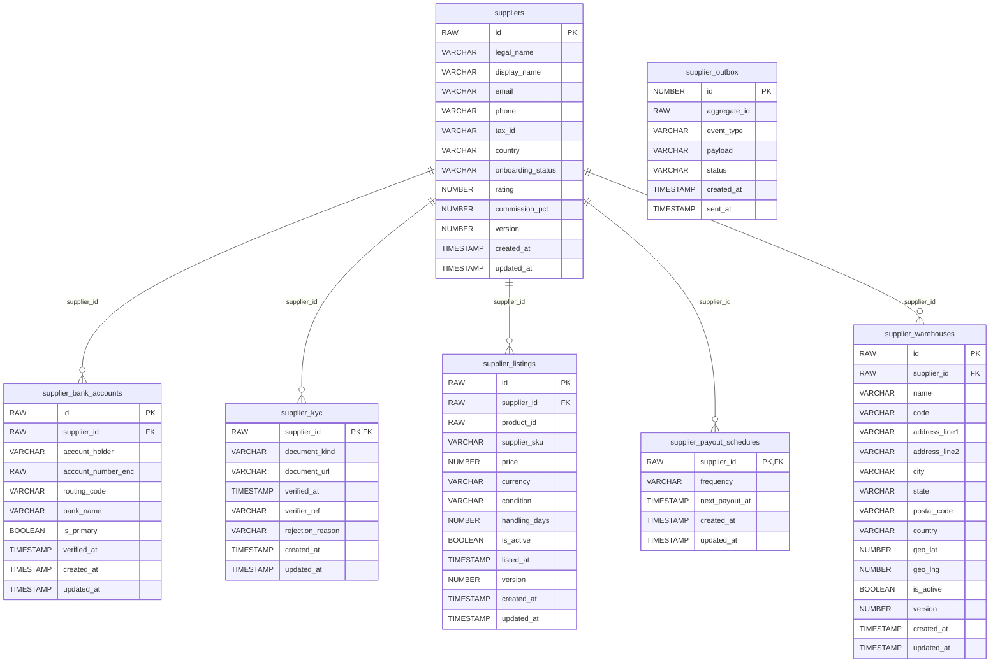

# ShopTrail Supplier Service

The seller side of ShopTrail: suppliers, KYC, supplier warehouses and offers (a supplier's price for a product).

Part of **ShopTrail**, a multi-seller marketplace. Full system reference: [`marketplace_tdd.md`](https://github.com/RaghuMHulkoti/shoptrail/blob/main/docs/marketplace_tdd.md).

| | |
|---|---|
| Live | https://supplier-service-tha0.onrender.com |
| Swagger UI | https://supplier-service-tha0.onrender.com/swagger-ui.html |
| Health | https://supplier-service-tha0.onrender.com/actuator/health |
| Local port | `8080` |
| Database | Oracle Autonomous DB, schema `SUPPLIER` (Flyway) |
| Stack | Java 21, Spring Boot 3.5, Spring Data JPA, Flyway |

## Responsibilities

- Create and update suppliers and their onboarding status.
- KYC submission and status.
- Supplier warehouses (with address and geo point), activate or deactivate.
- Offers: a supplier's price, condition and handling time for a catalogue product.
- Serves the **ShopTrail Sellers** portal at `/supplier.html` (only `SUPPLIER`, `OPS` and `ADMIN` accounts).

## How it fits

- REST in: the seller portal; cart-service and product-service read offers (`/api/v1/internal/offers`).
- The portal also calls product-service (products, brands, categories), inventory-manager (warehouses, stock) and user-service (sign-in).

## Run locally

Prerequisites: JDK 21+, Maven wrapper (included), the Oracle wallet of the shared database.

```bash
export DB_PASSWORD=...                       # Oracle password (never commit it)
export WALLET_DIR=/path/to/Wallet_ECOMMERCE  # unzipped Oracle wallet
./mvnw spring-boot:run
```

This repo's folder is named `Projects`. On JDK 26+ the Lombok version may need pinning to compile locally; CI builds on JDK 21.

Open http://localhost:8080/swagger-ui.html.

### Tests

```bash
./mvnw test
```

Tests run on H2 in Oracle mode.

### Docker

```bash
docker build -t shoptrail-supplier-service .
docker run -p 8080:8080 -e DB_PASSWORD=... -e WALLET_CWALLET_B64="$(base64 < cwallet.sso)" shoptrail-supplier-service
```

`docker-entrypoint.sh` unpacks the wallet from `WALLET_CWALLET_B64` when it is set.

## Configuration

All settings come from environment variables. Secrets have no defaults and must never be committed.

| Variable | Default | Purpose |
|---|---|---|
| `WALLET_DIR` | a local path | Folder of the Oracle wallet (local runs). On Render set `WALLET_CWALLET_B64` instead |
| `DB_USERNAME` | `ADMIN` | Oracle user |
| `DB_PASSWORD` | _(none, secret)_ | Oracle password. Required, no default |
| `OTEL_EXPORTER_OTLP_ENDPOINT` | `http://localhost:4318` | OTLP endpoint for metrics push (active only with `OTEL_METRICS_EXPORTER=otlp`) |
| `OTEL_SERVICE_NAME` | application name | `service.name` resource attribute |
| `SERVER_PORT` | `8080` | HTTP port |

## API

Responses are wrapped as `{"status", "message", "body"}`. The order of setup is: supplier, then warehouses and offers (a product must exist for an offer), then stock in inventory.

| Method | Path | Purpose |
|---|---|---|
| POST | `/api/v1/suppliers` | Create supplier |
| GET | `/api/v1/suppliers/{supplierId}` | Supplier |
| PATCH | `/api/v1/suppliers/{supplierId}` | Update supplier or status |
| POST | `/api/v1/kyc/{supplierId}/kyc` | Submit KYC document |
| GET | `/api/v1/kyc/{supplierId}/kyc` | KYC status |
| POST | `/api/v1/warehouses/{supplierId}/warehouses` | Create supplier warehouse |
| GET | `/api/v1/warehouses/{supplierId}/warehouses` | List supplier warehouses |
| GET | `/api/v1/warehouses/{supplierId}/warehouses/{warehouseId}` | One warehouse |
| PATCH | `/api/v1/warehouses/{supplierId}/warehouses/{warehouseId}` | Update warehouse |
| PATCH | `/api/v1/warehouses/{supplierId}/warehouses/{warehouseId}/status` | Activate or deactivate |
| POST | `/api/v1/internal/offers/{supplierId}/offers` | Create offer (price for a product) |
| GET | `/api/v1/internal/offers/{supplierId}/offers` | Supplier's offers |
| GET | `/api/v1/internal/offers/{supplierId}/offers/{offerId}` | One offer |
| PATCH | `/api/v1/internal/offers/{supplierId}/offers/{offerId}` | Update price or status |
| GET | `/api/v1/internal/offers/{offerId}` | Offer by id (cart) |
| GET | `/api/v1/internal/offers?productId=` | Offers for a product (cart, product) |
| GET | `/supplier.html` | Seller portal |

## Data model

Schema `SUPPLIER`. Full columns and constraints: [section 8 of the reference](https://github.com/RaghuMHulkoti/shoptrail/blob/main/docs/marketplace_tdd.md#8-data-model).



| Table | Holds | Created in |
|---|---|---|
| `suppliers` | Supplier identity, onboarding status, rating, commission | `V1__create_supplier_schema.sql` |
| `supplier_kyc` | KYC document and review | `V1__create_supplier_schema.sql` |
| `supplier_bank_accounts` | Encrypted bank accounts (not used by any flow yet) | `V1__create_supplier_schema.sql` |
| `supplier_warehouses` | Warehouses with address and geo point | `V1__create_supplier_schema.sql` |
| `supplier_listings` | Offers: price per product, condition, handling days | `V1__create_supplier_schema.sql` |
| `supplier_payout_schedules` | Payout frequency (not used yet) | `V1__create_supplier_schema.sql` |
| `supplier_outbox` | Supplier and offer events (written, not relayed yet) | `V1__create_supplier_schema.sql` |

## Events

Writes `OFFER_CREATED`, `OFFER_PRICE_UPDATED`, `OFFER_ACTIVATED`, `OFFER_DEACTIVATED`, `SUPPLIER_STATUS_UPDATED`, `SUPPLIER_KYC_SUBMITTED` and `SUPPLIER_WAREHOUSE_DECLARED` to `supplier_outbox` in the same transaction as the change. Nothing relays them yet (Kafka topic quota).

## Background jobs

None.

## How it works

- An offer is a `supplier_listings` row; its id is the `supplier_product_id` that inventory and orders use.
- Warehouse codes are unique per supplier.
- The seller portal's role check is done in the page; the API itself is open.

## Deployment

- Render web service (Docker), deployed manually or with `render deploys create <service-id>`.
- Set at least: `DB_PASSWORD`, `WALLET_CWALLET_B64`.
- CI: `.github/workflows/maven.yml` runs `mvn test`, builds the image, smoke-tests the container and pushes it to `ghcr.io`.
- Observability: `/actuator/health` (liveness and readiness probes), Prometheus at `/actuator/prometheus`, optional OTLP push.

## Known gaps

- Endpoints are open; no JWT or role check yet (the portal hides itself from customers only).
- KYC review, bank accounts and payouts have tables but no flow.
- Events are not published.
